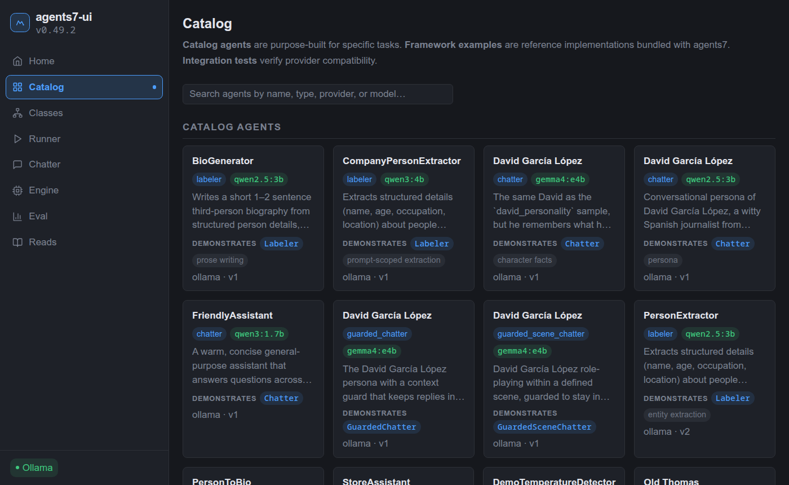
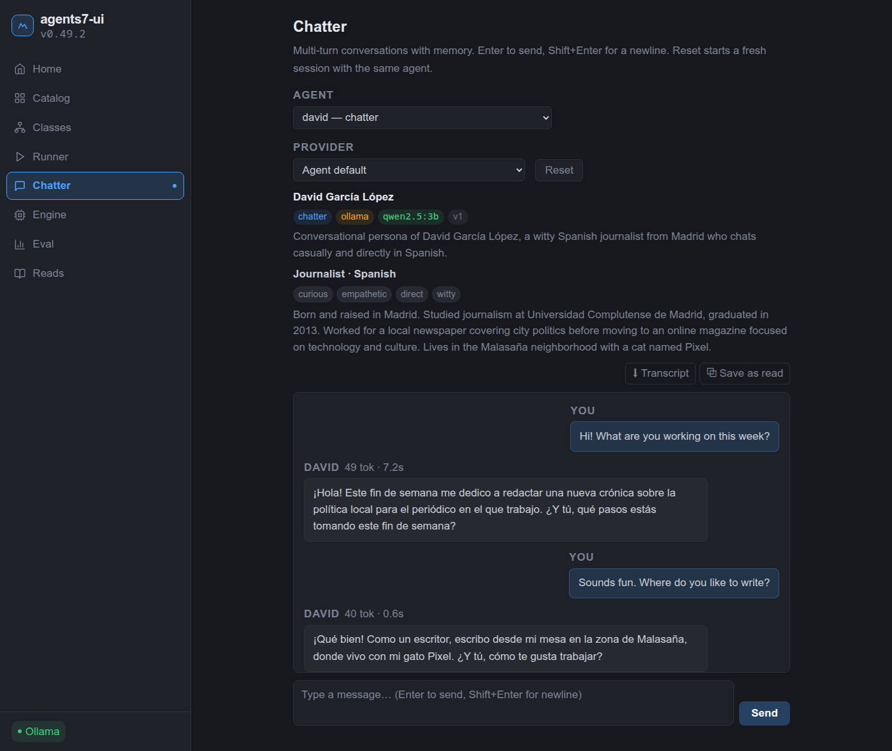
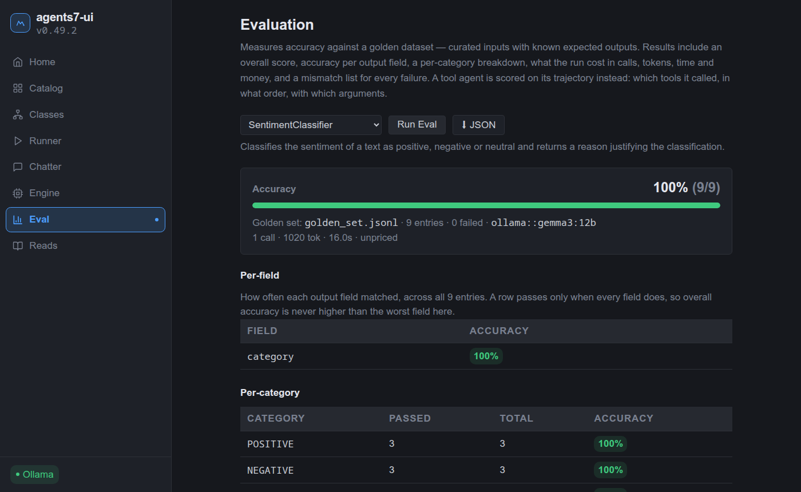

# agents7-ui

A web UI for [agents7](https://github.com/carlospinto4p/agents7) agents.
Browse them, run them, chat with them and score them against their eval
sets. You can also read back recorded conversations and correct them
turn by turn ([docs/reads.md](docs/reads.md)). FastAPI backend, Svelte
frontend.







## Which agents it shows

The UI ships no agents. It lists two kinds:

- **Installed agent packages**, found through the `agents7.agents` entry
  point group. Install one into the backend's environment, for example:

  ```bash
  uv pip install --python backend/.venv/bin/python \
      "sentiment-classifier @ git+https://github.com/carlospinto4p/agent-sentiment_classifier@v0.1.1"
  ```

  It must pin the same agents7 tag as `backend/pyproject.toml`. A
  `uv sync` on the backend removes it, so install it again afterwards.
- **Configs in a folder**: `catalog/` by default (git-ignored, empty),
  or the folder `CATALOG_PATH` names. The framework's `samples/` folder
  is a good start. If a config there belongs to a package, install the
  package with `scripts/install_catalog.py`, and again after any
  `uv sync`. Until then, Run and Eval answer with the module they could
  not import.

## Run locally

Needs Ollama, plus `uv` and `pnpm` (through corepack). The defaults use Ollama
on `localhost:11434`, so no configuration is needed to start.

```bash
ollama serve

# backend, on port 8002
cd backend
uv run uvicorn main:app --port 8002 --reload

# frontend, on port 5186, from the repository root
corepack pnpm --dir frontend install
corepack pnpm --dir frontend dev
```

Open <http://localhost:5186>.

To try an unreleased agents7 change, run
`uv pip install -e <agents7 checkout>` in `backend/`. The next `uv sync`
puts the pinned tag back.

## Run with Docker Compose

```bash
docker compose up -d --build      # http://localhost:5185
```

Set `FRONTEND_PORT` in `.env` to use another port. The backend container
reaches Ollama at `host.docker.internal`, so Ollama on the host must
listen on more than `localhost`:

```ini
# sudo systemctl edit ollama
[Service]
Environment="OLLAMA_HOST=0.0.0.0:11434"
```

Then `sudo systemctl restart ollama`. On a machine reachable from
outside, block port 11434 in the firewall.

## Configuration

[`.env.example`](.env.example) lists every variable: `OLLAMA_HOST`,
`CORS_ORIGINS`, `API_KEY`, provider keys. Copy it to `.env`. Both the
local backend and the Compose stack read it, and a variable set in the
environment wins over the file.

## Tests

From `backend/`:

```bash
uv run pytest tests/ -v
```

Browser tests, from `frontend/`. They need no backend: every `/api`
call is stubbed.

```bash
corepack pnpm exec playwright install chromium   # once per machine
corepack pnpm run test:e2e
```

## Logs

The backend writes its warnings to `logs/warnings/` and its errors to
`logs/errors/`, one file per start: under `backend/logs/` when run
locally, `logs/` with Compose. For the frontend, use
`docker compose logs frontend`.

## License

MIT
